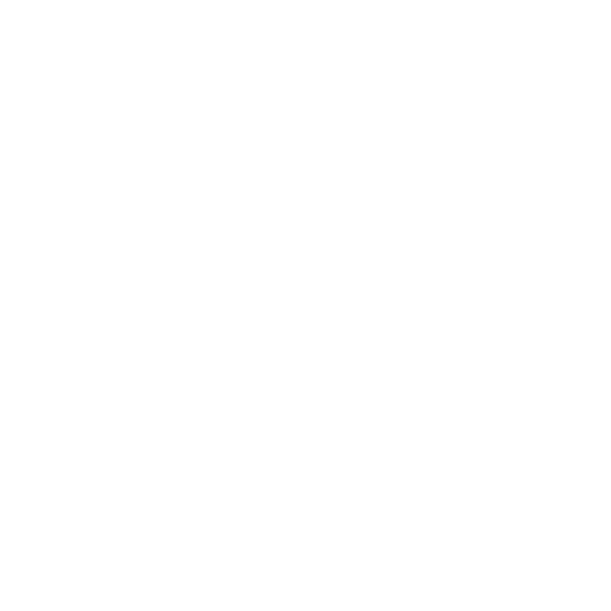
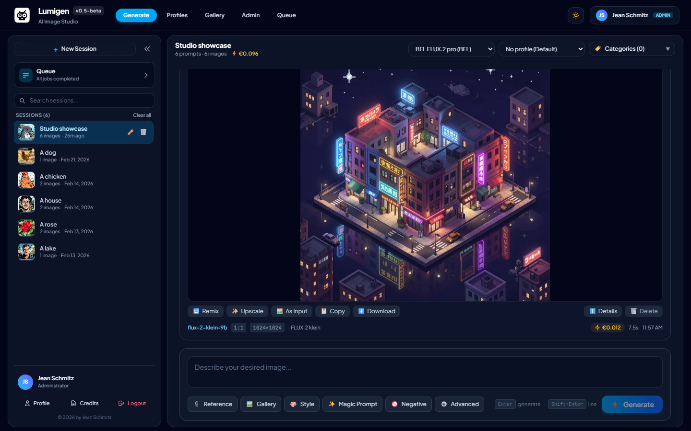
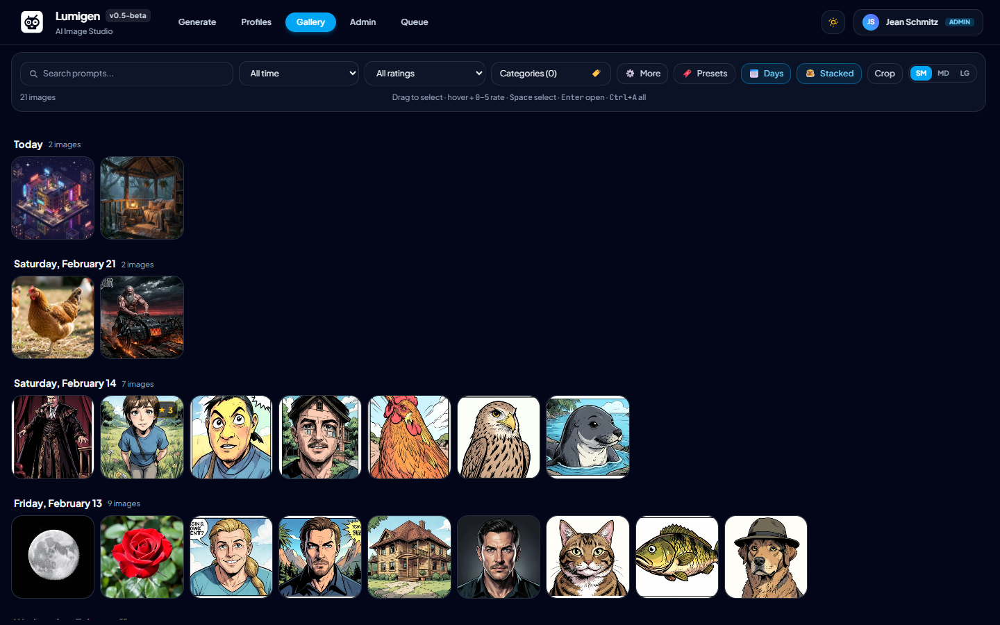
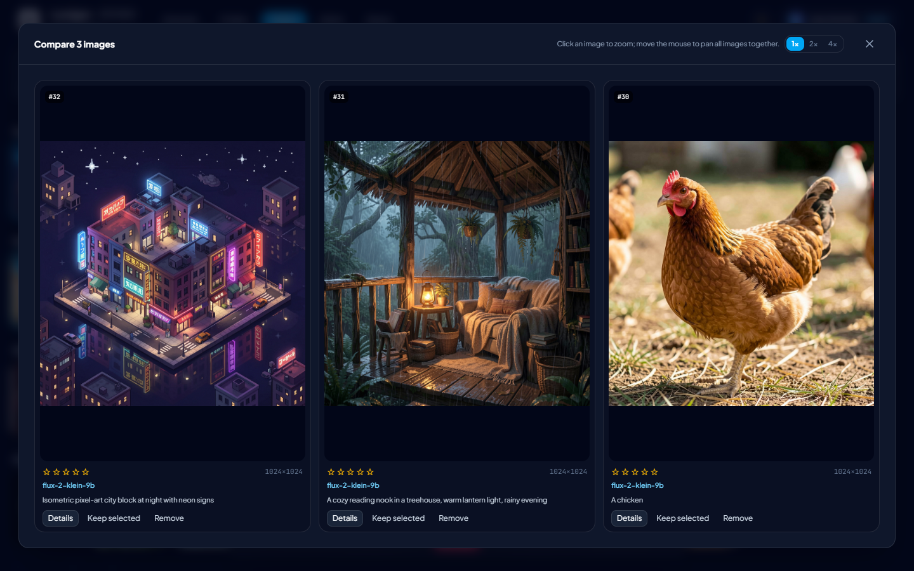

<div align="center">



# Lumigen

**One studio. Thirteen AI providers for images, video & vector graphics. Your media stays on your machine.**

A self-hosted, local-first AI creation studio: generate images, videos, and scalable vector graphics with FLUX, GPT-Image, Gemini, Seedream, Seedance, Kling, Recraft, Stable Diffusion, Ideogram, Grok and more — side by side, in one clean interface, without subscriptions or tracking.

[](LICENSE)


[Features](#-features) · [Providers](#-supported-providers) · [Quick start](#-quick-start) · [Configuration](#%EF%B8%8F-configuration) · [Docker](#-docker)

</div>

<br />



<table>
  <tr>
    <td width="50%"></td>
    <td width="50%"></td>
  </tr>
  <tr>
    <td align="center"><sub><b>Gallery</b> – grouped by day, virtualized, keyboard-driven</sub></td>
    <td align="center"><sub><b>Compare</b> – up to four images with synchronized zoom</sub></td>
  </tr>
</table>

<sub><i>Sample images were generated with Black Forest Labs FLUX.2 models for demonstration purposes.</i></sub>

---

## ✨ Features

<table>
<tr>
<td width="50%" valign="top">

### 🎨 Create
- **13 providers, one prompt box** – switch models and media types in a dropdown, no context switch
- **AI Video Generation** – text-to-video & image-to-video via ByteDance Seedance & fal.ai (Kling 2.5/1.5, Minimax Video-01, Hunyuan, Luma, LTX, Veo 3)
- **Vector Graphics (SVG)** – prompt-to-SVG vector output (e.g. Recraft V3) stored in pure XML without rasterization artifacts
- **Sessions as visual history** – every prompt, image, and video of a session in one unified feed
- **Live progress** – aspect-correct placeholders, elapsed timer, real cancel
- **Reference images** – upload or pick from the gallery for image-to-image and image-to-video
- **Magic Prompt** – LLM-powered prompt enhancement
- **Style presets** – reusable prompt fragments with live previews
- **Profiles** – save model, size, seed, categories, media type, and upscaling defaults

</td>
<td width="50%" valign="top">

### 🗂️ Organize
- **Fast gallery** – infinite scroll and virtualized rendering for thousands of images, videos, and vectors
- **Inline video & SVG badges** – first-frame video thumbnails (via ffmpeg), inline video playback, and distinct `SVG` / `Video` badges
- **Grouped by day** – "Today", "Yesterday", "Saturday, February 21" …
- **Drag-to-select & keyboard** – rubber-band selection, `0–5` to rate, `Space`, `Enter`, `Ctrl+A`
- **Compare view** – 2–4 images side by side with synchronized zoom & pan
- **Filters you can share** – filter by media type, rating, or provider; every filter lives in the URL
- **Stacks & categories** – group variations and versions, tag, rate, bulk-edit
- **ZIP export** – download any selection with one click

</td>
</tr>
<tr>
<td width="50%" valign="top">

### 💸 Stay in control
- **Token usage per image/video and per session** (optional)
- **Your own prices** – set cost per 1M input/output tokens or per generation, in any currency
- **Generation queue** – fire off many jobs; per-provider concurrency, spacing and retries
- **One-click retry** of failed jobs with identical settings
- **Upscaling** – fal.ai (Topaz & creative upscalers) or local Real-ESRGAN (automatically skipped for video & SVG)

</td>
<td width="50%" valign="top">

### 🔐 Own your studio
- **Local-first** – SQLite, files and JSON sidecars under `./data`, fully reproducible
- **Multi-user** – admin/user roles, self-service profile & password change
- **Password reset** – single-use tokens via e-mail (SMTP) or admin-issued links
- **Encrypted API keys** – stored with Fernet, per provider or per model
- **Import / export** – profiles, models and styles as JSON; sessions as ZIP
- **Docker ready** – one script to build and run

</td>
</tr>
</table>

---

## 🔌 Supported providers

| Provider | Example models | Notes |
|---|---|---|
| **Black Forest Labs** | FLUX.2 [pro] / [flex] / [klein], FLUX 3 | Native BFL API |
| **OpenAI** | gpt-image-1, DALL·E 3 | Reports token usage |
| **Google Gemini** | Gemini image models, Imagen | Reports token usage |
| **OpenRouter** | FLUX.2, GPT-5 Image, Seedream, … | One key, many models; reports token usage |
| **fal.ai** | FLUX, Kling Video (v2.5/v1.5), Minimax Video, Hunyuan, Recraft V3 (SVG), Luma Dream Machine | Image generation, video models (text-to-video & image-to-video), cloud upscaling, and SVG vector graphics |
| **ByteDance Seedance** | Seedance 2.5 / 2.0 / 1.5 Pro | Dedicated video generation on BytePlus ModelArk (text-to-video, resolutions up to 1080p, custom ratios) |
| **BytePlus ModelArk** | ByteDance Seedream 5.0 / 4.5 / 4.0 | Up to 10 reference images, sequential multi-image output, reports usage |
| **MiniMax** | image-01 | Subject reference support |
| **Stability AI** | Stable Image Ultra / Core, SD 3.5 | Image-to-image for Ultra & SD 3.5 |
| **Replicate** | Any hosted model, e.g. `black-forest-labs/flux-1.1-pro`, `recraft-ai/recraft-v3` | Supports image, video, and SVG vector models |
| **Together AI** | FLUX.2 [dev], FLUX.1.1 [pro], FLUX.1 [schnell] | Width/height from aspect ratio |
| **xAI** | Grok Imagine (`grok-imagine-image-2.0`) | Generation & edits, reports usage |
| **Ideogram** | Ideogram 3.0 Turbo / Default / Quality | Great typography, style references |

Add keys under **Admin → API Keys** (each provider links to its key page) or in `.env`.

> **Why no Midjourney?** Midjourney offers no official API, and its terms prohibit automated access.
> Lumigen only integrates official provider APIs.

---

## 🚀 Quick start

**Requirements:** Python 3.12+, [Poetry](https://python-poetry.org/docs/#installation) 2.x, Node.js 20+

```bash
git clone https://github.com/jschm42/anyimggen.git lumigen
cd lumigen

poetry install                  # Python deps into .venv/
npm ci                          # Windows PowerShell: npm.cmd ci
cp .env.example .env            # Windows: copy .env.example .env

poetry run lumigen-migrate      # create / upgrade the database
npm run build                   # build the Vue frontend
poetry run lumigen              # start on http://127.0.0.1:8010
```

On first start Lumigen asks you to create the admin account. Then:

1. **Admin → API Keys** – add a key for at least one provider.
2. **Admin → Models** – add a model (use *Discover* for suggestions) and optionally set prices.
3. **Generate** – pick the model, type a prompt, press <kbd>Enter</kbd>.

> **Tip:** for frontend development with hot reload run `npm run dev` alongside the backend.

---

## ⚙️ Configuration

All settings live in `.env` (see [`.env.example`](.env.example)). The most important ones:

| Variable | Purpose |
|---|---|
| `SESSION_SECRET_KEY` | **Required in production** – long random secret for session cookies |
| `SESSION_HTTPS_ONLY` | `true` when served via HTTPS |
| `PROVIDER_CONFIG_KEY` | Fernet key for encrypted API keys (`scripts/generate_provider_key.sh` / `.ps1`) |
| `OPENAI_API_KEY`, `GOOGLE_API_KEY`, `BFL_API_KEY`, `FAL_API_KEY`, `OPENROUTER_API_KEY`, `MINIMAX_API_KEY` | Provider keys (alternatively set in the Admin UI) |
| `STABILITY_API_KEY`, `REPLICATE_API_KEY`, `TOGETHER_API_KEY`, `XAI_API_KEY`, `IDEOGRAM_API_KEY` | Additional image generation provider keys |
| `BYTEPLUS_API_KEY`, `SEEDANCE_API_KEY` | BytePlus ModelArk: Seedream image models and Seedance video models (`SEEDANCE_API_KEY` falls back to `BYTEPLUS_API_KEY`) |
| `BYTEPLUS_BASE_URL` | ModelArk region endpoint (default: `https://ark.ap-southeast.bytepluses.com/api/v3`) |
| `SMTP_HOST`, `SMTP_PORT`, `SMTP_USERNAME`, `SMTP_PASSWORD`, `SMTP_FROM` | Optional e-mail delivery for password reset links |
| `PUBLIC_BASE_URL` | Base URL used in reset links (defaults to the request URL) |
| `PROXY_HEADERS_ENABLED` | Trust `X-Forwarded-*` headers behind a reverse proxy |

### Token usage & costs

Enable **Admin → General → Show token usage** to display tokens on every generation and per session.
Costs appear only for models with prices configured under **Admin → Models**
(per 1M input tokens, per 1M output tokens and/or per image). The currency is set once under
**Admin → General**. Prices are snapshotted per generation, so later price changes never rewrite history.

### Accounts & password reset

- Users manage their profile and password under **My Profile** (sidebar, bottom left).
- *Forgot password?* on the login page issues a single-use token (60 min). With SMTP configured it is
  e-mailed; otherwise the link is written to the server log, and admins can create reset links under
  **Admin → Users**.
- Changing or resetting a password signs out all other sessions of that user.

<details>
<summary><b>Behind a reverse proxy / production checklist</b></summary>

```dotenv
SESSION_SECRET_KEY=<long-random-secret>
SESSION_HTTPS_ONLY=true
PROXY_HEADERS_ENABLED=true
PROXY_HEADERS_TRUSTED_HOSTS=10.0.0.1      # your proxy, avoid * when possible
AUTH_ALLOW_ONBOARDING_RESET=false
```

Run `poetry run lumigen-migrate` after every update.

</details>

<details>
<summary><b>Video thumbnails with ffmpeg (recommended for video generation)</b></summary>

Lumigen automatically extracts crisp first-frame poster thumbnails for generated videos using `ffmpeg`.
Ensure `ffmpeg` is available in your system `PATH` (or standard installation locations like `/usr/bin/ffmpeg`, `C:\Program Files\ffmpeg\bin`, or via package managers such as `choco install ffmpeg` / `brew install ffmpeg` / `apt install ffmpeg`).

</details>

<details>
<summary><b>Local upscaling with Real-ESRGAN (optional, Linux)</b></summary>

1. Download the [Real-ESRGAN NCNN Vulkan](https://github.com/xinntao/Real-ESRGAN/releases) binary and model files
   (e.g. `realesrgan-x4plus.param` + `.bin`).
2. Configure:

```dotenv
UPSCALER_COMMAND=/usr/local/bin/realesrgan-ncnn-vulkan
UPSCALER_MODEL_DIR=./data/models/realesrgan
```

**Docker:** either copy the binary to `docker/realesrgan-ncnn-vulkan` before building (it is installed
automatically), or place it in `./data/bin/` and set `UPSCALER_COMMAND=/app/data/bin/realesrgan-ncnn-vulkan`
and `UPSCALER_MODEL_DIR=/app/data/models/realesrgan`. If you see `libvulkan.so.1: cannot open shared object file`,
rebuild the image with `./scripts/docker_update.sh`.

</details>

---

## 🐳 Docker

```bash
./scripts/docker_run.sh          # Windows: .\scripts\docker_run.ps1
```

Open <http://127.0.0.1:7003>. Update after pulling changes with `./scripts/docker_update.sh`
(or `.ps1`). Data is shared via `DOCKER_DATA_DIR` (default `./data`).

---

## 🧱 Tech stack

| Layer | Technology |
|---|---|
| Backend | Python 3.12, FastAPI, SQLAlchemy 2, Alembic, SQLite, httpx, Pillow, ffmpeg |
| Frontend | Vue 3, Vite, Pinia, Vue Router, Tailwind CSS 4, TypeScript |
| Quality | pytest, ruff, vue-tsc, Playwright, pre-commit |

<details>
<summary><b>Development</b></summary>

```bash
poetry run pre-commit install            # lint gate on every commit
python -m pytest -q tests/unit tests/providers tests/db
python -m ruff check app/
cd frontend && npx vue-tsc -b            # type-check the SPA
npx playwright test                      # end-to-end tests
```

- Schema changes need a model change **and** an Alembic migration in `alembic/versions/`.
- Provider logic lives in `app/providers/*_adapter.py`; orchestration in `ProviderRegistry`.
- Release notes: [`docs/releases/`](docs/releases/). Bump the version with `python scripts/update_version.py <version>`.

</details>

---

## 📜 License

Lumigen is released under the [MIT License](LICENSE). Third-party notices: [`THIRD_PARTY_LICENSES.md`](THIRD_PARTY_LICENSES.md).
Generated images are subject to the terms of the provider and model you use — see **Credits & Licenses** in the app.

<div align="center">
<sub>© 2026 by Jean Schmitz</sub>
</div>
